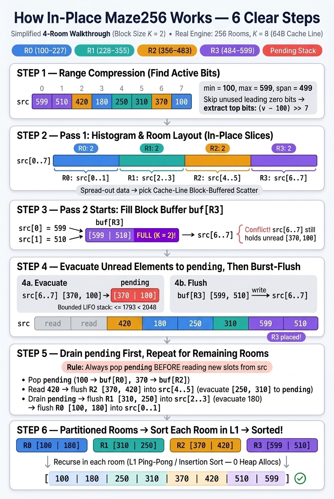

# In-Place Maze256 — Algorithm Design & Pseudocode

This document explains the **In-Place Maze256** sorting algorithm used in `fastsort`, the traditional sorting problems it was designed to overcome, the mathematical invariants that keep its memory strictly $O(1)$, and full language-agnostic pseudocode for both the single-threaded and multi-core parallel engines.

---

## 1. The Traditional Problem

Sorting large arrays of integers or fixed-width keys has historically forced a painful three-way trade-off between **speed**, **memory**, and **robustness across data distributions**:

| Traditional Approach | Fundamental Bottleneck |
|---|---|
| **Comparison Sorts** (`pdqsort`, Quicksort, Timsort, Introsort) | Bound by $\Omega(n \log n)$ comparisons. On random keys, conditional comparisons suffer heavy CPU branch misprediction penalties and touch each element $O(\log n)$ times. |
| **Out-of-Place Radix Sort** (Classic LSD / MSD) | Achieves $O(n \cdot d)$ linear time, but requires an **$O(n)$ auxiliary array** (e.g., 80 MB for 10M `int64`s). This doubles memory bandwidth, evicts CPU caches, and triggers garbage-collector pauses in managed runtimes (Go, V8). |
| **Classic In-Place MSD Radix Sort** (American Flag Sort, 1993) | Solves the $O(n)$ memory wall by permuting cycles element-by-element in place, **but** scatters single elements across 256 random memory locations. On large arrays, this causes severe **cache-line thrashing**, write-allocate traffic, TLB misses, and serial dependency chains on every swap. |
| **Naive Parallel Radix Sort** | Splits work across 256 buckets in parallel, **but** collapses to single-core speed on skewed, heavy-tailed, or staircase distributions where one bucket holds 50–99% of the input. |

### How In-Place Maze256 Solves These Problems

**In-Place Maze256** treats each 8-bit radix level as a layout of **256 contiguous rooms** (`0..255`) and combines six complementary techniques so you get linear-time throughput with **$O(1)$ heap memory** and **consistent performance across distributions**:

1. **Range-Adaptive Span Compression:** Computes `[minVal, maxVal]` via unsigned two's-complement subtraction, automatically skipping unused leading bits, handling signed and unsigned integers identically, and finishing any span $\le 255$ in a single direct counting-sort pass.
2. **Cache-Line Block-Buffered Scatter + Provably Bounded Spill Stack:** Replaces American Flag Sort's random single-element swaps with 64-byte cache-line block writes (`blockSize = 8`), using a fixed LIFO `pending` spill stack mathematically proven never to exceed $1793 < 2048$ elements regardless of input size $n$.
3. **Adaptive In-Place Routing Gate:** Measures the histogram before routing. Spread-out distributions use cache-line block-buffered scatter; skewed or sparse distributions switch to zero-write cycle-leader routing that skips already-placed elements and avoids moving a dominant bucket.
4. **L1-Resident Ping-Pong Leaves:** As soon as a subarray fits inside L1 cache ($n \le 4096$), Maze256 switches from in-place scatter to an out-of-place MSD radix sort ping-ponging between the slice and a fixed, hoisted L1 buffer — eliminating in-place routing overhead where memory is fastest.
5. **Sparse-Room Checkpoints:** Tracks occupied rooms with a 256-bit TZCNT bitmask (Go) or compact active-room list (JS), so sparse passes never waste time scanning empty buckets.
6. **Adaptive Hybrid Parallelism (`Maze256Parallel`):** Uses a parallel histogram to choose between work-stealing parallel room sorting (for spread-out inputs) and branchless BlockQuicksort / 3-way Dutch National Flag splitting (for skewed or duplicate-heavy inputs) so all CPU cores stay balanced.

---

## 2. Worked Example (Visual Walkthrough)



> **Reading the 6 steps:** Starting from `src = [599, 510, 420, 180, 250, 310, 370, 100]`, Step 1 computes `min = 100`, `max = 599`, `span = 499` (`(v - 100) >> 7` for this 4-room illustration). Step 2 histograms the rooms and carves `src` into 4 contiguous room slices. Step 3 fills `buf[R3] = [599, 510]`, hitting unread elements `[370, 100]` at `src[6..7]`. Step 4 evacuates `[370, 100]` onto the bounded `pending` stack before burst-flushing `[599, 510]` into `src[6..7]`. Step 5 drains `pending` before reading new elements from `src` until every room is partitioned, and Step 6 finishes each room independently in L1 cache with zero heap allocations.

---

## 3. High-Level Dispatch Architecture

```text
Input array A[0..n)
  │
  ├── n <= smallCutoff (256 in Go / 48 in JS) ──► Insertion sort / stdlib sort
  ├── Monotonic ascending or descending ────────► O(n) no-op or in-place reverse
  ├── n <= 4096 (fits in L1 cache) ─────────────► StackMazePingPong (hoisted L1 aux)
  └── n > 4096 ─────────────────────────────────► InPlaceMaze:
        1. Scan minVal, maxVal -> unsigned span = uint(maxVal) - uint(minVal)
        2. If span == 0            -> return (all equal)
        3. If bitLen(span) <= 8    -> Direct 1-pass in-place counting sort & return
        4. Pass 1: 256-bucket histogram on top 8 active bits (shift = bitLen - 8)
        5. Prefix sums + active-room tracking (roomMask / activeList, maxCount)
        6. Pass 2 (Adaptive In-Place Routing):
             ├─ activeRooms >= 32 AND maxCount < 0.75 * n:
             │    ScatterBlockBuffered (64B cache-line bursts + bounded pending stack)
             └─ Otherwise (skewed / sparse):
                  RouteCycleLeader (zero-write cycle swaps, skips in-place & lastRoom)
        7. Recurse on each occupied room with count > 1
             (automatically switches to StackMazePingPong when count <= 4096)
```

---

## 4. Core Techniques Explained

### 4.1 Range-Adaptive Span Compression

Traditional fixed-width radix sorts always run 8 passes on 64-bit integers (4 passes on 32-bit), even if every value lies inside a narrow window like `[1_700_000_000, 1_700_000_200]`. They also require separate code paths or sign-bit flipping for signed vs. unsigned types.

Maze256 computes:

```text
minU   = unsigned(minVal)
span   = unsigned(maxVal) - minU           // exact modulo 2^W two's-complement wrap
bitLen = W - countLeadingZeros(span)       // number of active bits in [1..W]
```

Because two's-complement unsigned subtraction preserves ordering across the entire signed range (including `[MinInt64, MaxInt64]`), subtracting `minU` maps every element `v` monotonically into `[0, span]` without overflow:

- **`span == 0`:** Every element is identical; return immediately.
- **`bitLen <= 8` (`span < 256`):** All remaining values fit in a single 256-entry count table. Maze256 histograms `(v - minU)` and overwrites the slice directly with `minU + r` repeated `counts[r]` times — finishing in one linear pass with no routing or recursion.
- **`bitLen > 8`:** Sets `shift = bitLen - 8` and extracts the **highest 8 differing bits**: `bucket = (unsigned(v) - minU) >> shift`. Any shared leading prefix (whether zeros, ones, or common high bits of timestamps/IDs) is skipped in a single step, guaranteeing at least 8 bits of progress per recursion level (at most 8 levels for 64-bit, 4 levels for 32-bit).

---

### 4.2 Cache-Line Block-Buffered Scatter & Bounded Spill Stack Proof

In a 256-way in-place scatter, writing one element at a time to 256 scattered locations thrashes the L1/L2 cache. Inspired by **IPS²Ra**, Maze256 assigns every room `r` a small fixed buffer `buf[r][0..K)` where $K = \text{blockSize} = 8$ (64 bytes for `int64` = one full x86/ARM cache line; 32 bytes for `int32`).

Each room `r` owns the half-open slice `[offsets[r], ends[r])` and maintains two cursors:
- `writePos[r]`: next slot to flush a full block of elements belonging to room `r`.
- `readPos[r]`: next unread original element in room `r`'s region.

We maintain the invariant `readPos[r] >= writePos[r]` at all times:
1. Whenever `buf[dest]` fills to $K$ elements, we prepare to write `buf[dest][0..K)` to `src[wp : wp+K]`.
2. If `wp + K > readPos[dest]`, the flush would overwrite `newWP - rp` unread elements sitting in `src[rp : newWP]`. Before writing the block, we **evacuate** those unread elements onto a LIFO stack `pending`, and advance `readPos[dest] = newWP`.
3. On every loop step, we **always pop from `pending` first** if `pendingLen > 0`, and only read a fresh element from `src[readPos[r]++]` when `pendingLen == 0`.

#### Why `pending` Never Overflows (`pendingLen <= 1793 < 2048`)

Unlike IPS²Ra (which runs a separate multi-pass block-permutation cleanup phase), the "drain `pending` before reading `src`" rule guarantees a strict, input-independent upper bound on `pendingLen`.

**Proof:**
Let $K = \text{blockSize} = 8$, $B = \sum_{r=0}^{255} \text{bufLen}[r]$ be the total elements held across all 256 room buffers, and $P = \text{pendingLen}$ be the number of elements on the spill stack. Define the total off-array inventory $S = P + B$.

- **Case 1 ($P = 0$):** No room buffer is full yet, so every room holds at most $K - 1$ elements:
  $$S = B \le 256(K - 1)$$
  We read 1 fresh element from `src` (increasing $S$ by $1$).
  - If it does not trigger a flush, $P$ stays $0$ and $S \le 256(K - 1)$.
  - If it fills `buf[dest]`, we write $K$ elements back into `src` ($-K$) and evacuate $\Delta = \max(0, \text{newWP} - \text{rp}) \le K$ unread elements into `pending` ($+\Delta$). Net change:
    $$S_{\text{after}} \le 256(K - 1) + 1 - K + \Delta \le 256(K - 1) + 1$$
- **Case 2 ($P > 0$):** We do **not** read from `src`; we pop 1 element from `pending` ($-1$) and place it into `buf[dest]` ($+1$).
  - If no flush occurs, $\Delta S = 0$.
  - If a flush occurs, $K$ elements move into `src` and $\Delta \le K$ elements are evacuated to `pending`, so $\Delta S = \Delta - K \le 0$.

By induction, at every step of the algorithm:

$$P \le P + B = S \le 256(K - 1) + 1$$

For $K = 8$:

$$P \le 256 \times 7 + 1 = 1793 < 2048$$

Thus a fixed `[2048]T` stack array can **never overflow** on any input size $n$ or adversarial permutation. Once all `readPos[r]` reach `ends[r]`, no unread elements remain anywhere in `src`, so draining `pending` and flushing the partial tail blocks `buf[r][0..bufLen[r])` can never overwrite unread data.

---

### 4.3 Adaptive In-Place Routing Gate

Block buffering shines when elements fan out across many buckets, amortizing cache-line writes across 256 rooms. However, on **skewed or sparse inputs** (e.g., 90% of values in 1 room, or only 4 active rooms):
- Block buffering would unconditionally copy all $n$ elements into `buf` and write them back to `src`, even if 90% of them were already sitting in their target room!

Maze256 checks two cheap metrics already computed during the prefix-sum pass:

```text
if activeRooms >= 32 AND maxCount < (3 * n) / 4:
    ScatterBlockBuffered(...)   // Spread-out: maximize cache-line write throughput
else:
    RouteCycleLeader(...)       // Skewed/sparse: zero-write in-place skips
```

In **Cycle-Leader Routing**:
- Any element already in its target room (`dest == r`) simply advances `wp++` with **zero writes**.
- Elements out of place follow their permutation cycle in registers until an element belonging to room `r` arrives back at `wp`.
- The final active room (`lastRoom`) is **skipped completely**, because once the first `activeRooms - 1` rooms contain their exact elements, the last room is guaranteed to hold only its own elements.

---

### 4.4 L1-Resident Hoisted Ping-Pong (`StackMazePingPong`)

Once a subarray shrinks to $n \le 4096$ elements ($\le 32\text{ KB}$ for `int64`, $\le 16\text{ KB}$ for `int32`), both `src` and a scratch slice `aux` fit comfortably inside the CPU's L1/L2 cache. At this scale, simple sequential out-of-place scatter is faster than maintaining block buffers or chasing permutation cycles.

`StackMazePingPong` allocates **zero heap memory** by reusing a single pre-hoisted `aux[4096]` buffer:
- A boolean flag `inAux` tracks whether the current subarray lives in `orig` (`false`) or `aux` (`true`).
- Each radix pass scatters from `src` into `dst`, then recurses with `(dst, src, !inAux)` — **ping-ponging** data back and forth with no bulk copy between passes.
- Only when hitting a base case (`n <= insertionLimit`, `minVal == maxVal`, `bitLen <= 8`, or a singleton room `c == 1`) does it ensure the final sorted output lands in `orig`.

---

### 4.5 Sparse-Room Checkpoints

When only 3 out of 256 rooms are occupied, scanning all 256 histogram entries on every phase (routing, tail flushing, recursion) adds avoidable loop overhead.

- **Go (TZCNT Bitmask):** Stores occupied rooms in `var roomMask [4]uint64` (256 bits total). Iterating over active rooms uses hardware `TZCNT` (`bits.TrailingZeros64(rm)`) and clears the lowest set bit (`rm &= rm - 1`), executing strictly `activeRooms` iterations.
- **JavaScript (Compact Active List):** Stores occupied room indices in a pre-allocated `Uint8Array(256)` (`active[0..activeRooms)`), avoiding 64-bit `BigInt` overhead in V8 while still visiting strictly `activeRooms` entries.

---

### 4.6 Multi-Core Hybrid Parallelism (`Maze256Parallel`)

In Go, `Maze256Parallel` scales across up to `min(GOMAXPROCS, 32)` goroutines with **$O(\text{procs})$ metadata (~26 KB)** and **zero $O(n)$ auxiliary arrays**:

1. **Phase 1 — Parallel Min/Max + Monotonicity:** Splits `data` evenly across `procs` chunks, computes per-chunk `(min, max, asc, desc)`, and merges chunk boundaries. Sorted inputs return immediately; descending inputs run a parallel in-place reverse.
2. **Phase 2 — Parallel Histogram & 8-bit Fast Path:** Each worker fills its own private `[256]int` counter table (zero atomic contention). If `bitLen <= 8`, workers claim active values via an `atomic.Int32` index and fill disjoint slices of `data` in parallel.
3. **Phase 3 — Adaptive Parallel Gate:**
   - **Spread-out (`activeRooms >= 32` and `maxCount < n / 2`):** Runs `scatterBlockBuffered` to partition into 256 disjoint rooms, then launches `procs` workers that dynamically steal rooms via `atomic.Int32`. Each worker hoists one `[4096]T` L1 buffer on its own stack.
   - **Skewed / Heavy-Tailed / Staircase (`activeRooms < 32` or `maxCount >= n / 2`):** A 256-way split would leave one massive room bottlenecking a single core. Instead, `Maze256Parallel` delegates to `parallelSplitAndMaze`:
     - Takes **65 evenly spaced samples** and sorts them to choose the median `pivot = samples[32]`.
     - If `samples[16] == samples[48]` (at least ~50% of the data equals the pivot), runs a **3-way Dutch National Flag partition** so the entire middle equal region is finished immediately without further sorting.
     - Otherwise, runs a **branchless BlockQuicksort 2-way partition** (`blk = 64` offset buffers `offL`/`offR` to avoid branch mispredictions on comparisons), recursing in parallel down to depth $\lfloor \log_2(\text{procs}) \rfloor + 2$ before handing each balanced chunk to single-threaded `Maze256`.

---

### 4.7 Runtime-Specific Optimizations

#### Go: Tiered `//go:noinline` Stack Frames
Putting `[4096]T`, `[256][8]T`, and `[2048]T` (~64 KB for `int64`) directly inside `Maze256` would force Go to allocate and zero 64 KB of stack even when sorting 100 elements. Instead, `Maze256` dispatches to three `//go:noinline` frame wrappers:
- `n <= 256`: `slices.Sort` (tiny frame)
- `n <= 1024`: `inPlaceMazeSmall` (`[1024]T` stack frame only)
- `n <= 4096`: `inPlaceMazeMed` (`[4096]T` stack frame only)
- `n > 4096`: `inPlaceMazeLarge` (`[4096]T` + `[256][8]T` + `[2048]T`, all on the stack → `0 B/op`, `0 allocs/op`)

#### JavaScript / V8: Monomorphic `Int32Array` Core & Zero-Copy Bijections
V8 TurboFan achieves peak speed when hot loops operate on a single TypedArray type (`Int32Array`) with pure 32-bit integer arithmetic (`| 0`, `>>>`, `Math.clz32`). Calling a generic function with mixed TypedArray types makes inline caches polymorphic and triggers deoptimizations.

- **Hoisted Realm Scratch Pools:** `I32_AUX`, `I32_BUF`, `I32_PENDING`, `COUNTS[0..4]`, etc. are allocated once at module load (zero per-call GC allocations).
- **`Uint32Array` → `Int32Array`:** Wraps the same underlying `ArrayBuffer` with a zero-copy `Int32Array` view, flips the sign bit (`view[i] ^= 0x80000000`) so unsigned order matches signed order, runs `maze256Int32`, and flips the sign bit back.
- **`Float32Array` → `Int32Array` (Exact IEEE-754 Involution):**
  1. Wraps the buffer in a zero-copy `Int32Array` view.
  2. Moves all `NaN`s (`(u & 0x7fffffff) > 0x7f800000`) to the end of the array (matching `Float32Array.prototype.sort()`).
  3. Transforms every non-`NaN` bit pattern `u` with the branchless **self-inverse involution**:
     $$f(u) = u \oplus ((u \gg_{\text{arith}} 31) \mathbin{\&} \texttt{0x7fffffff})$$
     - Positive floats (`sign == 0`): `mask = 0x00000000` → unchanged (already in ascending signed `Int32` order).
     - Negative floats (`sign == 1`): `mask = 0x7fffffff` → flips all 31 magnitude bits while keeping the sign bit `1`, reversing negative float order so `-Infinity < -1.5 < -0.0 < +0.0 < +1.5 < +Infinity` holds in standard signed `Int32` order!
  4. Sorts the non-`NaN` prefix with `maze256Int32`.
  5. Applies the **exact same involution** $f(f(u)) = u$ to restore the original IEEE-754 float bits.
- **8-bit & 16-bit TypedArrays:** Route directly to dedicated 1-pass range-adaptive counting sort (`COUNTS` / `COUNTS_16`), achieving 9x–10.7x speedups over V8 `.sort()`.

#### Rust / LLVM: `MaybeUninit` Tiered Frames, Spread-Out Range Propagation & Single-Scope Parallelism
Rust's standard `slice::sort_unstable` (`ipnsort`) already uses branchless partitioning and sorting networks, so the Rust implementation pairs In-Place Maze256 with LLVM-focused optimizations:
- **Uninitialized Tiered Stack Frames (`MaybeUninit<T>`):** `#[inline(never)]` wrappers (`in_place_maze_small`, `in_place_maze_med`, `in_place_maze_large`) keep all buffers on the stack (`0 B` heap, `no_std`-ready) without zero-initializing up to 64 KB on entry.
- **Spread-Out Range Propagation:** When a level is spread out (`active_rooms >= 32`), child recursive calls receive `(min_u, shift)` directly so L1 ping-pong leaves skip redundant `min`/`max` full-array scans, automatically falling back to `min`/`max` if a sub-bucket becomes skewed.
- **4-Way Unrolled Histograms, `[u16; 256]` L1 Tables & Sorting-Network Leaves:** Large histograms accumulate into four independent `[usize; 256]` tables to avoid store-to-load forwarding stalls; L1 ping-pong metadata uses compact `[u16; 256]` tables (512 bytes each); leaves `<= 128` delegate to `slice::sort_unstable` (branchless sorting networks); 8-bit types (`i8`/`u8`) fill via vectorized `memset` (`slice::fill`) at `0.64 ns/el`.
- **Single-Scope Barrier + Parallel Split (`maze256_parallel`):** Runs parallel min/max + monotonicity detection (and parallel reverse / parallel 8-bit counting fill) inside a single `std::thread::scope` + `std::sync::Barrier`, then partitions general keys (`span >= 256`) in parallel via median-of-65 branchless BlockQuicksort / 3-way Dutch National Flag into balanced chunks sorted concurrently across all cores by `maze256`.
- **Exact `f32`/`f64` `total_cmp` Involution:** Reinterprets `&mut [f32]`/`&mut [f64]` in-place as `&mut [i32]`/`&mut [i64]` using `u ^ ((u >> 31) & 0x7fffffff)` (or `>> 63` for `f64`), which is an exact order isomorphism with Rust's `f32::total_cmp` and `f64::total_cmp` across all bit patterns including `-NaN` and `+NaN`.

---

## 5. Pseudocode

### 5.1 Top-Level Dispatch (`Maze256`)

```text
CONST SMALL_CUTOFF    = 256     // (48 in JS)
CONST INSERTION_LIMIT = 64      // (48 in JS)
CONST STACK_BUF_SIZE  = 4096
CONST BLOCK_SIZE      = 8       // 8 x int64 = 64-byte cache line
CONST PENDING_CAP     = 2048    // Provably > 256*(BLOCK_SIZE - 1) + 1 = 1793

PROCEDURE Maze256(A[0..n)):
    IF n <= SMALL_CUTOFF:
        SmallSort(A)            // slices.Sort (Go) / InsertionSort (JS)
        RETURN

    IF HandleMonotonic(A):      // O(n) check: return if asc, reverse if desc
        RETURN

    IF n <= STACK_BUF_SIZE:
        Allocate fixed L1 scratch aux[0..n)
        StackMazePingPong(A, aux, inAux = FALSE)
        RETURN

    Allocate fixed scratch on stack / hoisted pool:
        aux[0..STACK_BUF_SIZE)
        buf[0..256)[0..BLOCK_SIZE)
        pending[0..PENDING_CAP)

    InPlaceMaze(A, aux, buf, pending)
```

---

### 5.2 Core Recursive Engine (`InPlaceMaze`)

```text
PROCEDURE InPlaceMaze(src[0..n), aux, buf, pending):
    IF n <= INSERTION_LIMIT:
        InsertionSort(src)
        RETURN
    IF n <= STACK_BUF_SIZE:
        StackMazePingPong(src, aux[0..n), inAux = FALSE)
        RETURN

    // Step 1: Range scan (min/max)
    minVal, maxVal = MinMax(src)
    IF minVal == maxVal:
        RETURN

    // Step 2: Unsigned two's-complement span & active bit-width
    minU   = unsigned(minVal)
    span   = unsigned(maxVal) - minU
    bitLen = WORD_BITS - CountLeadingZeros(span)

    counts[0..256) = 0

    // Step 3: Direct 1-pass counting sort if span fits in 8 bits
    IF bitLen <= 8:
        FOR v IN src:
            counts[uint8(unsigned(v) - minU)] += 1
        out = 0
        FOR r = 0 TO span:
            IF counts[r] > 0:
                Fill src[out .. out + counts[r]) WITH cast_T(minU + r)
                out += counts[r]
        RETURN

    // Step 4: Pass 1 — Histogram on top 8 active bits
    shift = bitLen - 8
    FOR v IN src:
        bucket = uint8((unsigned(v) - minU) >> shift)
        counts[bucket] += 1

    // Step 5: Prefix sums, active-room tracking, skew metrics
    total = 0; activeRooms = 0; maxCount = 0; lastRoom = 0
    activeSet = EMPTY           // [4]uint64 TZCNT bitmask in Go; Uint8Array in JS
    FOR r = 0 TO 255:
        c = counts[r]
        IF c > 0:
            Add r TO activeSet
            offsets[r]  = total
            writePos[r] = total
            total      += c
            ends[r]     = total
            lastRoom    = r
            activeRooms += 1
            maxCount    = max(maxCount, c)

    // Step 6: Pass 2 — Adaptive In-Place Routing
    IF activeRooms > 1:
        IF activeRooms >= 32 AND maxCount < (3 * n) / 4:
            ScatterBlockBuffered(src, minU, shift, activeSet, offsets, writePos, ends, buf, pending)
        ELSE:
            RouteCycleLeader(src, minU, shift, activeSet, writePos, ends, lastRoom)

    // Step 7: Recurse into occupied rooms
    FOR EACH r IN activeSet:
        IF counts[r] > 1:
            InPlaceMaze(src[offsets[r] .. ends[r]), aux, buf, pending)
```

---

### 5.3 Cache-Line Block-Buffered In-Place Scatter (`ScatterBlockBuffered`)

```text
PROCEDURE ScatterBlockBuffered(src, minU, shift, activeSet, offsets, writePos, ends, buf, pending):
    FOR EACH r IN activeSet:
        readPos[r] = offsets[r]
        bufLen[r]  = 0
    pendingLen = 0

    // Phase A: Scan all unread elements across all active rooms
    FOR EACH r IN activeSet:
        WHILE readPos[r] < ends[r]:
            // Always drain pending BEFORE reading fresh elements from src
            // (maintains invariant: pendingLen + sum(bufLen) <= 256*(BLOCK_SIZE-1) + 1)
            IF pendingLen > 0:
                pendingLen -= 1
                v = pending[pendingLen]
            ELSE:
                v = src[readPos[r]]
                readPos[r] += 1

            dest = uint8((unsigned(v) - minU) >> shift)
            bl   = bufLen[dest]
            buf[dest][bl] = v
            bl += 1

            IF bl == BLOCK_SIZE:
                wp    = writePos[dest]
                newWP = wp + BLOCK_SIZE
                rp    = readPos[dest]

                // Evacuate any unread elements that this block write would overwrite
                IF newWP > rp:
                    FOR k = rp TO newWP - 1:
                        pending[pendingLen] = src[k]
                        pendingLen += 1
                    readPos[dest] = newWP

                // Flush full cache-line block into src
                Copy buf[dest][0..BLOCK_SIZE) INTO src[wp..newWP)
                writePos[dest] = newWP
                bufLen[dest]   = 0
            ELSE:
                bufLen[dest] = bl

    // Phase B: Drain remaining elements from pending (all src slots are now read)
    WHILE pendingLen > 0:
        pendingLen -= 1
        v    = pending[pendingLen]
        dest = uint8((unsigned(v) - minU) >> shift)
        bl   = bufLen[dest]
        buf[dest][bl] = v
        bl += 1

        IF bl == BLOCK_SIZE:
            wp = writePos[dest]
            Copy buf[dest][0..BLOCK_SIZE) INTO src[wp .. wp + BLOCK_SIZE)
            writePos[dest] = wp + BLOCK_SIZE
            bufLen[dest]   = 0
        ELSE:
            bufLen[dest] = bl

    // Phase C: Flush partial tail blocks
    FOR EACH r IN activeSet:
        bl = bufLen[r]
        IF bl > 0:
            Copy buf[r][0..bl) INTO src[writePos[r] .. writePos[r] + bl)
```

---

### 5.4 Zero-Write Cycle-Leader Routing (`RouteCycleLeader`)

```text
PROCEDURE RouteCycleLeader(src, minU, shift, activeSet, writePos, ends, lastRoom):
    FOR EACH r IN activeSet:
        IF r == lastRoom:
            BREAK               // Last room is already valid once all others finish

        wp  = writePos[r]
        end = ends[r]

        WHILE wp < end:
            v    = src[wp]
            dest = uint8((unsigned(v) - minU) >> shift)

            IF dest == r:       // Already in its home room: zero writes!
                wp += 1
                CONTINUE

            // Follow permutation cycle until an element for room r returns
            LOOP:
                nextPos = writePos[dest]
                writePos[dest] += 1
                SWAP(v, src[nextPos])
                dest = uint8((unsigned(v) - minU) >> shift)
                IF dest == r:
                    src[wp] = v
                    wp += 1
                    BREAK

        writePos[r] = wp
```

---

### 5.5 L1-Resident Hoisted Ping-Pong (`StackMazePingPong`)

```text
PROCEDURE StackMazePingPong(src[0..n), dst[0..n), inAux):
    IF n <= INSERTION_LIMIT:
        InsertionSort(src)
        IF inAux:
            Copy src[0..n) INTO dst[0..n)
        RETURN

    minVal, maxVal = MinMax(src)
    IF minVal == maxVal:
        IF inAux:
            Copy src[0..n) INTO dst[0..n)
        RETURN

    minU   = unsigned(minVal)
    span   = unsigned(maxVal) - minU
    bitLen = WORD_BITS - CountLeadingZeros(span)
    counts[0..256) = 0

    IF bitLen <= 8:
        FOR v IN src:
            counts[uint8(unsigned(v) - minU)] += 1
        target = (inAux ? dst : src)
        out = 0
        FOR r = 0 TO span:
            IF counts[r] > 0:
                Fill target[out .. out + counts[r]) WITH cast_T(minU + r)
                out += counts[r]
        RETURN

    shift = bitLen - 8
    FOR v IN src:
        counts[uint8((unsigned(v) - minU) >> shift)] += 1

    total = 0; activeSet = EMPTY
    FOR r = 0 TO 255:
        IF counts[r] > 0:
            Add r TO activeSet
            offsets[r]  = total
            writePos[r] = total
            total      += counts[r]

    // Out-of-place scatter into dst (both src and dst are L1-resident)
    FOR v IN src:
        r = uint8((unsigned(v) - minU) >> shift)
        dst[writePos[r]] = v
        writePos[r] += 1

    // Ping-pong recursion: swap roles of src and dst, flip inAux
    FOR EACH r IN activeSet:
        c  = counts[r]
        st = offsets[r]
        IF c == 1:
            IF NOT inAux:
                src[st] = dst[st]       // Copy singleton back to original array
            CONTINUE
        StackMazePingPong(dst[st .. st + c), src[st .. st + c), NOT inAux)
```

---

### 5.6 Multi-Core Hybrid Parallel Sort (`Maze256Parallel`)

```text
CONST PARALLEL_CUTOFF     = 32768
CONST PARALLEL_LEAF_LIMIT = 16384
CONST PARALLEL_MAX_PROCS  = 32

PROCEDURE Maze256Parallel(data[0..n), procs):
    IF procs <= 1 OR n < PARALLEL_CUTOFF:
        Maze256(data)
        RETURN
    procs = min(procs, PARALLEL_MAX_PROCS)

    // Phase 1: Parallel min/max + monotonicity scan across procs chunks
    PARALLEL FOR p = 0 TO procs - 1:
        stats[p] = ScanMinMaxAndMonotonic(data[chunk_p])
    minVal, maxVal, asc, desc = MergeChunkStats(stats, chunkBoundaries)

    IF minVal == maxVal OR asc:
        RETURN
    IF desc:
        ParallelReverse(data, procs)
        RETURN

    minU   = unsigned(minVal)
    span   = unsigned(maxVal) - minU
    bitLen = WORD_BITS - CountLeadingZeros(span)

    IF bitLen <= 8 AND n < 250000:
        DirectCountingSort(data, minU, span)
        RETURN

    // Phase 2: Contention-free parallel 256-bucket histogram
    shift = (bitLen > 8 ? bitLen - 8 : 0)
    PARALLEL FOR p = 0 TO procs - 1:
        localCounts[p] = Histogram256(data[chunk_p], minU, shift)
    counts, offsets, writePos, ends, activeList, maxCount = ReduceHistograms(localCounts)

    IF bitLen <= 8:
        // Lock-free dynamic fill of disjoint value ranges
        ParallelCountingFill(data, minU, offsets, ends, activeList, procs)
        RETURN

    // Phase 3: Adaptive parallel gate
    IF activeRooms < 32 OR maxCount >= n / 2:
        // Skewed / heavy-tailed: partition into balanced chunks across all cores
        depth = BitLength(procs) + 1
        ParallelSplitAndMaze(data, depth)
        RETURN

    // Spread-out: 256-way block-buffered scatter, then work-stealing room sort
    ScatterBlockBuffered(data, minU, shift, ...)

    nextRoom = AtomicInt(0)
    PARALLEL FOR p = 0 TO procs - 1:
        Allocate worker-local L1 stackAux[0..STACK_BUF_SIZE)
        LOOP:
            idx = nextRoom.FetchAdd(1)
            IF idx >= activeRooms: BREAK
            sub = data[offsets[activeList[idx]] .. ends[activeList[idx]])
            IF len(sub) <= INSERTION_LIMIT:   InsertionSort(sub)
            ELSE IF len(sub) <= STACK_BUF_SIZE: StackMazePingPong(sub, stackAux, FALSE)
            ELSE:                             InPlaceMazeLarge(sub)

PROCEDURE ParallelSplitAndMaze(data[0..n), depth):
    IF depth <= 0 OR n < PARALLEL_LEAF_LIMIT:
        Maze256(data)
        RETURN

    samples[0..65) = EvenlySpacedSamples(data, 65)
    Sort(samples)
    pivot = samples[32]

    // Heavy duplicates around median: 3-way partition resolves equal middle immediately
    IF samples[16] == samples[48]:
        (lt, gt) = Partition3Way(data, pivot)
        SPAWN ParallelSplitAndMaze(data[0..lt), depth - 1)
        ParallelSplitAndMaze(data[gt..n), depth - 1)
        WAIT
        RETURN

    // Branchless BlockQuicksort 2-way partition (64-element offset buffers)
    mid = PartitionBlockBranchless(data, pivot)
    IF mid == 0 OR mid == n:
        Maze256(data)
        RETURN

    SPAWN ParallelSplitAndMaze(data[0..mid), depth - 1)
    ParallelSplitAndMaze(data[mid..n), depth - 1)
    WAIT
```

---

### 5.7 IEEE-754 `Float32` Zero-Copy Order Involution (JS)

```text
PROCEDURE Maze256Float32(floats[0..n)):
    view = Int32ViewOverSameBuffer(floats)   // Zero-copy reinterpretation

    // Partition NaNs to the tail & map non-NaNs monotonically onto signed Int32
    end = n; i = 0
    WHILE i < end:
        u = view[i]
        IF (u & 0x7FFFFFFF) > 0x7F800000:    // IEEE-754 NaN check
            end -= 1
            SWAP(view[i], view[end])
        ELSE:
            view[i] = u XOR ((u >>_arith 31) & 0x7FFFFFFF)
            i += 1

    IF end > 1:
        Maze256Int32(view[0..end))

    // Exact same involution restores original IEEE-754 bit patterns
    FOR i = 0 TO end - 1:
        u = view[i]
        view[i] = u XOR ((u >>_arith 31) & 0x7FFFFFFF)
```

---

## 6. Complexity & Space Analysis

Let $n$ be the number of elements, $W \in \{8, 16, 32, 64\}$ be the key bit-width, and $B_{\text{span}} = \lceil \log_2(\max - \min + 1) \rceil \le W$ be the active bit-span of the input.

| Metric | `Maze256` (Go) | `Maze256Parallel` (Go) | `maze256` (JS/TS) | `maze256` (Rust) | `maze256_parallel` (Rust) |
|---|---|---|---|---|---|
| **Best-case time** (monotonic / constant) | $O(n)$ | $O(n / P)$ | $O(n)$ | $O(n)$ | $O(n / P)$ |
| **Narrow-span time** ($\text{span} < 256$) | $O(n)$ (1 pass) | $O(n / P)$ | $O(n)$ (1 pass) | $O(n)$ (1 pass) | $O(n / P)$ |
| **Expected & Worst-case time** | $O(n \cdot \lceil B_{\text{span}} / 8 \rceil)$ | $O((n / P) \cdot \lceil B_{\text{span}} / 8 \rceil)$ | $O(n \cdot \lceil B_{\text{span}} / 8 \rceil)$ | $O(n \cdot \lceil B_{\text{span}} / 8 \rceil)$ | $O((n / P) \cdot \lceil B_{\text{span}} / 8 \rceil)$ |
| **Max recursion depth** | $\le \lceil W / 8 \rceil \le 8$ | $\le \lceil W / 8 \rceil + \log_2 P + 2$ | $\le \lceil 32 / 8 \rceil = 4$ | $\le \lceil W / 8 \rceil \le 8$ | $\le \lceil W / 8 \rceil + \lceil \log_2 P \rceil$ |
| **Per-call heap allocations** | **`0 B/op`, `0 allocs/op`** | $O(P)$ (~26 KB for $P=8$) | **`0 B/op`** (hoisted realm pools) | **`0 B`, `0 allocs`** (`no_std`) | $O(P)$ (OS thread stacks only) |
| **Auxiliary space** | $O(1)$ (fixed stack frames, $\le 64\text{ KB}$) | $O(P)$ (no $O(n)$ buffers) | $O(1)$ (~300 KB once per realm) | $O(1)$ (fixed `MaybeUninit` stack, $\le 64\text{ KB}$) | $O(P)$ (no $O(n)$ buffers) |
| **Stability** | Unstable | Unstable | Unstable (exact `TypedArray.sort()` float order) | Unstable (exact `f32`/`f64::total_cmp`) | Unstable (exact `f32`/`f64::total_cmp`) |

---

## 7. Inspirations & References

- **American Flag Sort** — P. M. McIlroy, K. Bostic, M. D. McIlroy, *"Engineering Radix Sort"*, Computing Systems, 1993. (In-place MSD radix cycle routing.)
- **Ska Sort** — Malte Skarupke, *"I Wrote a Faster Sorting Algorithm"*, 2016. (In-place MSD radix engineering and base-case tuning.)
- **IPS²Ra (In-Place Parallel Super Scalar Radix Sort)** — M. Axtmann, S. Witt, D. Ferizovic, P. Sanders, 2020. (Cache-line block-buffered in-place scatter.)
- **BlockQuicksort** — S. Edelkamp & A. Weiß, *"BlockQuicksort: Avoiding Branch Mispredictions in Quicksort"*, ESA 2016. (Branchless 64-element offset-buffer partitioning used in `Maze256Parallel`'s skewed-distribution path.)
